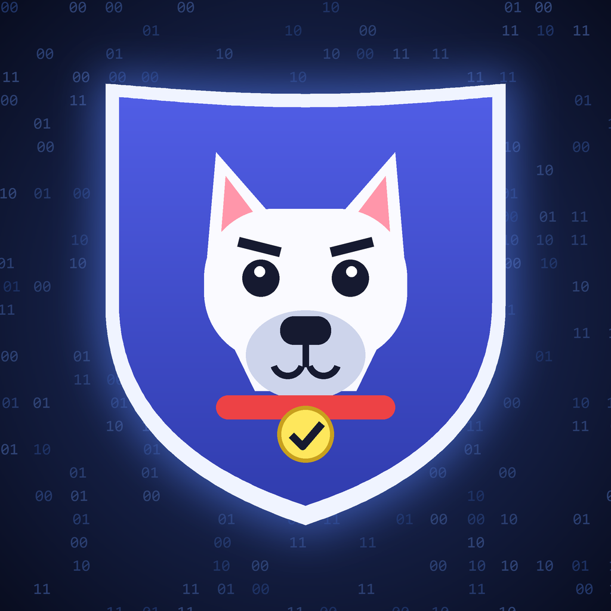
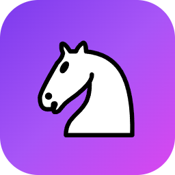
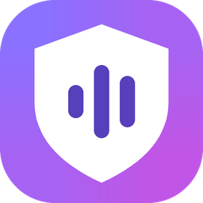

  
  
  
  

**I build practical tools people actually run: Windows desktop apps, a from-scratch chess engine, and self-learning Discord moderation.** 
Each project ships as a download or a one-command setup, with a README that explains how it works.

---

## Featured projects

<table>
<tr>
<td width="110" align="center"></td>
<td>

### [ByteDog](https://github.com/BucketSe/ByteDog)
**A self-learning Discord bot that stops scam images and malicious files.** 
Reads text in images, GIFs and video with OCR, decodes QR codes, spots executables disguised as pictures, and fingerprints known scams. Moderator feedback trains it, so it improves on your server over time.

    

</td>
</tr>
<tr>
<td width="110" align="center"></td>
<td>

### [ChessAi](https://github.com/BucketSe/ChessAi)
**Desktop chess analysis board with Stockfish 19 and a chess engine written from scratch in C++.** 
Best-move arrows, top lines, an evaluation graph, a board editor, PGN/FEN import, 5 app themes and 6 piece sets. The home-made engine uses magic bitboards, PVS alpha-beta search and a tapered evaluation, and is checked with perft suites and engine-vs-engine games.

     
[**Download for Windows**](https://github.com/BucketSe/ChessAi/releases/latest)

</td>
</tr>
<tr>
<td width="110" align="center"></td>
<td>

### [Ad Guard for Spotify](https://github.com/BucketSe/Spotify-Blocker)
**Windows app that mutes or skips Spotify ads automatically.** 
Watches the desktop client, then either mutes the ad or restarts Spotify and resumes your music. Includes now-playing with album art, playback controls and a history of blocked ads. Ships as a single portable `.exe`.

     
[**Download for Windows**](https://github.com/BucketSe/Spotify-Blocker/releases/latest)

</td>
</tr>
</table>

---

## What I work with

**Strengths across these projects:** native Windows apps packaged for one-click download, performance-minded C++ (bitboards, search, UCI), computer vision and OCR pipelines, and bots that learn from the people who use them.

---

## GitHub at a glance

---

More projects are added here as they ship. &nbsp;·&nbsp; Built under <b>Concept Bytes</b>

